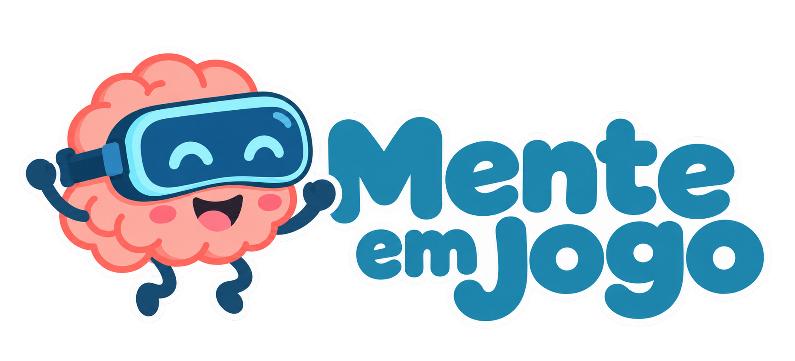

# Mente em Jogo

Repositório de distribuição da ferramenta **Mente em Jogo**. Este repositório contém somente instruções de uso e os pacotes de instalação publicados nas [Releases](../../releases); o código-fonte não é distribuído aqui.

## Sobre a aplicação

**Mente em Jogo** é uma aplicação de realidade mista para Meta Quest 3 destinada ao apoio ao desenvolvimento de habilidades atencionais de crianças com Transtorno do Espectro Autista (TEA). A ferramenta reúne três atividades lúdicas, graduais e de baixa sobrecarga sensorial:

- **Amigo dos Animais** — identificação do objeto solicitado e entrega ao animal correspondente; ênfase em atenção seletiva.
- **Encontre e Guarde** — busca de um objeto entre elementos distintos e armazenamento no local indicado; ênfase em atenção sustentada.
- **Hora da Colheita** — cuidado da horta, colheita dos itens e organização nas caixas correspondentes; ênfase em atenção dividida.

O acompanhamento é realizado por uma aplicação Windows, que controla a sessão e permite exportar resultados em JSON, CSV e PDF. As métricas de orientação são estimadas pela direção da cabeça/câmera; a aplicação não utiliza rastreamento ocular.

## Contexto acadêmico

Projeto desenvolvido por **Rogério Machado Medeiros Dias** durante o Mestrado em Engenharia Informática e Tecnologia Web da Universidade Aberta de Portugal (UAb), em parceria com a Universidade de Trás-os-Montes e Alto Douro (UTAD).

**Dissertação:** *Ambiente Imersivo em Realidade Mista para Apoio ao Desenvolvimento Cognitivo de Crianças com Transtorno do Espectro Autista*.

## Download e instalação

Baixe a versão mais recente na seção [Releases](../../releases/latest). O pacote ZIP inclui o aplicativo do instrutor para Windows e o APK para Meta Quest 3.

Consulte o [guia de instalação](Docs/Installation.md) para instalar o APK, preparar o headset e iniciar uma sessão acompanhada.

## Licença

O software é disponibilizado sob a [PolyForm Noncommercial License 1.0.0](https://polyformproject.org/licenses/noncommercial/1.0.0/). São permitidos o uso, estudo, modificação e redistribuição para fins não comerciais, incluindo pesquisa e educação. O uso comercial não é permitido. Os ativos, SDKs, plugins e demais dependências de terceiros permanecem sujeitos às respectivas licenças.
